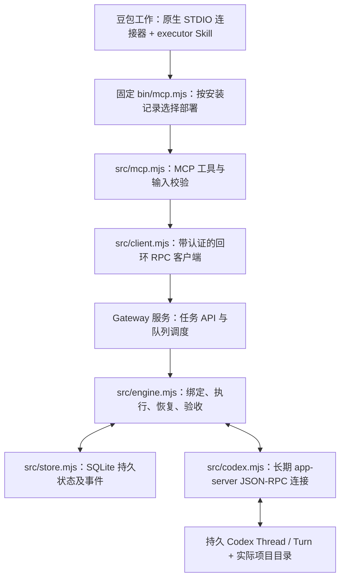
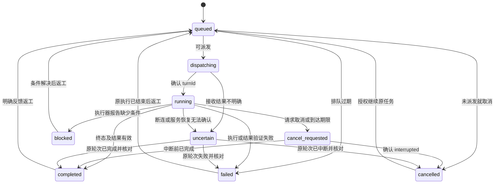

# 架构与持久工作流

本项目将豆包工作作为任务发起者和验收者，将本机 Codex app-server 作为执行器。设计参考 [codex-workbuddy-gateway](https://github.com/dudu555-djiao/codex-workbuddy-gateway) 的监督执行模式，但代码独立实现。参考项目的 WorkBuddy UI/原生桥接方案没有用于这里；本项目不依赖其源码许可证授予任何权利。

本仓库使用 [MIT License](../LICENSE)。文中描述的是实现约束和已验证行为，不是对任意账号、客户端版本或操作系统的兼容保证。

## 进程职责



MCP 适配器与服务分离。豆包可以为连接器启动或结束适配器进程，而持久队列由独立服务持有。macOS LaunchAgent 使用 `RunAtLoad` 和 `KeepAlive` 在用户登录会话中维持服务；不是系统级云执行器，睡眠/关机期间没有执行保证。后台任务的持久执行不等于豆包对话持续在线：当前没有心跳自动唤醒或向已经结束的对话主动通知的接口，对话结束后需重新查询原任务。

RPC 只在本机回环地址暴露，使用状态目录中的令牌认证。STDIO 适配器负责把 MCP 请求转换为内部方法调用；内部 `/rpc` 不是远程 MCP 服务器。每次 RPC 前，客户端重新读取 `connection.json` 及其指向的令牌文件，不在豆包配置中固定令牌。后台服务重启或令牌轮换后，后续调用读取新连接信息；重启期间失败的请求不会被透明重投。

## 本机部署布局

默认根目录是当前用户的 `~/Library/Application Support/DoubaoCodexGateway`，其下包含：

```text
DoubaoCodexGateway/
  config.local.json
  installation.json
  bin/
    mcp.mjs
  deployments/
    <安装时间戳>/
      src/
      node_modules/
      package.json
      package-lock.json
  data/
    gateway.sqlite
    connection.json
    service.log
    service.error.log
    …
```

CLI 安装时把自身运行代码与依赖复制到独立部署目录，写入 `installation.json`，记录源码目录和实际运行目录。LaunchAgent 的工作目录、运行脚本和日志都指向 Application Support。Node 本身不复制，服务使用安装时 `process.execPath` 指向的可执行文件。

开发验证中，直接从 Desktop 启动 LaunchAgent 曾在 Node 执行前出现 `EX_CONFIG`。将运行入口放入 Application Support，可避免把源码所在的桌面目录作为服务启动依赖。执行项目仍受实际目录权限与 Codex 沙箱限制。

`GATEWAY_STATE_DIR` 覆盖 `data` 位置；未指定 `GATEWAY_CONFIG` 时，配置默认位于该状态目录的父目录。安装器把这两个解析后的路径写入服务环境。MCP 适配器必须连接同一个状态目录。`install` 写入固定 `bin/mcp.mjs` 启动器，每次新启动都读取 `installation.json` 并载入当前部署的 MCP 实现；`connector-config` 在该入口可用时输出 Node、固定脚本及所需环境变量。没有固定入口的旧安装或未安装的开发环境会使用相应部署/源码入口，应以命令输出为准。

更新源码不会热替换部署代码。应在无活动、排队或未知状态任务时卸载服务再安装，新部署目录与旧部署并存，持久数据保持原位。卸载移除 LaunchAgent 注册并保留停用 plist 备份，不删除任务数据或产物。旧连接器需迁移一次到固定入口；此后在 Node 路径和状态目录未变化的前提下，升级无需随部署目录修改参数，但必须重新连接 MCP/刷新工具，让新进程读取当前安装记录。已有 MCP 进程不会自动热更新已载入的工具代码。

## 连接恢复不等于任务重放

本地连接分为三个独立层次：

| 层次 | 恢复机制 | 不代表什么 |
| --- | --- | --- |
| 豆包 → MCP | 固定启动器在新连接时选择当前部署；工具更新后重连/刷新 | 不保证豆包永远保持同一个 MCP 进程 |
| MCP → Gateway | 每次 RPC 读取当前连接文件和令牌；LaunchAgent 维持服务 | 不透明重试失败的提交，也不需复制令牌到豆包 |
| Gateway → Codex app-server | 传输断开时单一重连流程、指数退避恢复连接 | 不重新派发任务，不自动解除 `uncertain` 容量 |

自动重连仅恢复传输通道，不调用新的 `turn/start` 重做原工作，也不把原任务直接改回 `running`。连接恢复后，监督者仍应查询持久任务，并按需要用 `codex_recover` 核对原始精确 Turn。服务启动时的原 Turn 核对与断连后的传输重连是不同流程。

这些机制要求本机开机、用户已登录、Node/Codex 和服务文件可用，以及所用账号和网络可用。它们不承诺永不中断、不执行关机期间的计算，也不把连接绑定到当前 Codex 聊天窗口。关闭聊天与停止后台服务是不同操作；豆包对话结束后也不会因此继续主动监督或推送。

## 大图片历史的有界传输

Codex 的会话读取或恢复回复可能包含历史图片项中的 `imageGeneration.result` 内联图像数据。旧传输实现对原始 JSON 消息设置统一 32 MiB 上限；当历史图片使消息超过该值时，可能在模型真正开始新任务前断开连接。只检查传输已重连，无法证明同一历史回复能被正确处理。

当前修复在传输接收阶段流式省略协议允许的图片项位置中的 `imageGeneration.result`，不先累计完整图像字符串再整体解析。省略对象仅限此内联媒体字段：Thread/Turn 的完整结构、全部轮次与标识，以及文字、`savedPath`、状态和失败信息仍保留。普通结果中的同名 `result` 字段不因此被删除。

这是本地传输投影，不改写 Codex 历史、任务数据库、后端会话上下文或原始图片文件。图片收集继续依赖已完成图片的真实本地路径，轮次核对、幂等、防止重复执行和不确定状态保护均沿用原语义；不裁掉旧 Turn，不猜测最新 Turn，也不自动新建 Thread 绕过问题。

媒体省略不等于取消所有资源限制。当前传输解析器的默认限制为：

| 范围 | 默认上限 |
| --- | --- |
| 原始传输帧，包括被省略的图片数据 | 512 MiB |
| 省略图片数据后保留的 JSON | 32 MiB |
| JSON 嵌套深度 | 128 |
| JSON 值的数量 | 500,000 |

这些是传输保护限制，不是图片交付数量、单张原图复制大小或模型上下文额度。超限返回 `CODEX_MESSAGE_TOO_LARGE`，非法 JSON 或协议返回 `PROTOCOL_ERROR`；不会静默截断正文后继续执行。具体错误应结合健康检查、任务状态及服务日志判断，不应把每次断连都归因为网络。

健康响应的 `connectionScope: "transport_only"` 明确表示连接状态只覆盖传输。`lastProtocolError` 保留最近一次协议错误的 `{code, message, at}`；没有记录时为 `null`。成功重连不清除该记录，服务进程重启后可以清空。它是诊断线索，不是当前所有会话读取失败的证明，也不能代替原任务的状态核对。

## 持久数据模型

SQLite 使用 WAL 模式。主要表如下：

| 表 | 作用 |
| --- | --- |
| `bindings` | `workspace` → `threadId`、模型、绑定状态 |
| `runs` | 任务目标、约束、执行状态、验收状态、当前轮次、结果、历史 |
| `requests` | 幂等键、请求指纹、任务 ID |
| `events` | 单调递增序号、任务 ID、事件类型、JSON 内容、时间 |

任务、幂等键和初始事件在同一个 SQLite 事务中创建；状态变更与对应事件也在事务中保存。任务结构以 JSON 保存，事件保留可继续读取的 `seq` 游标。

标识符的职责不同：

- `id`：Gateway 任务 ID，返工保留不变。
- `idempotencyKey`：某个提交或返工意图的稳定键。
- `threadId`：工作区对应的持久 Codex 会话。
- `turnId`：一次真实执行的精确标识；恢复必须匹配它。
- `attempt`：Gateway 内的执行轮次；返工时递增。
- `cursor` / `seq`：任务事件续读位置。

同一键加相同请求指纹返回已有任务；同一键加不同请求被拒绝。提交和返工使用不同的键命名空间。客户端传输不会对失败的请求做透明重试。

## 提交和派发

1. 将工作区解析为真实路径，验证它位于 `allowedRoots` 内。
2. 查找幂等记录；存在则返回已有任务。
3. 取得工作区绑定，必要时调用 `thread/start` 创建非临时会话。
4. 写入 `queued` 任务和初始事件。
5. 调度器检查全局并发容量及工作区/会话占用；已有持久执行记录的 Thread 使用恢复流程，当前进程刚创建且尚未执行的 Thread 直接使用。
6. 先持久化 `dispatching` 与容量占用，再调用 `turn/start`。
7. 保存返回或通知中的 `turnId`，进入 `running`。
8. 接收完成通知，验证结构化结果和产物，将执行结果持久化。

新会话创建发生在任务入队前。绑定本身有 `creating/ready/uncertain` 状态：若会话创建响应丢失，不能盲目再建一个，会要求显式绑定经过核实的 Thread。调度前持久化意图可避免服务重启后把已提交但响应丢失的执行当成未执行任务重发。

Codex 在第一轮执行前可能还没有保存 rollout，因此刚创建的空会话不能立即通过 `thread/resume` 恢复。网关在当前进程中记录新建会话并直接派发；重启后，只有明确得到“没有 rollout”错误且所有关联任务都不存在持久化派发意图/Turn 的情况下，才允许替换从未执行过的空会话。该例外不会重放已经提交的工作；不能排除曾经派发时仍保留错误与人工核查要求。

默认 `maxConcurrent: 1`。允许配置到 4，但同一工作区或同一 Thread 有占用任务时不会继续派发。未知状态也保留占用，因为原始执行可能仍在进行。

## 模型选择与返工

任务显式 `model` 优先于工作区绑定模型，绑定模型优先于 Gateway 配置模型。新建绑定时，网关配置为空则交由 Codex 使用其默认值；绑定建立后会保留模型。修改网关默认模型不会覆盖既有绑定，也不会覆盖任务显式模型。

`codex_models` 读取模型目录，不验证当前账号是否支持实际推理或是否有余额。模型请求失败会保留失败结果，不自动切换另一个模型。

`codex_rework` 保留原任务的显式 `model` 和其他执行设置，只添加反馈并开启新轮次；接口没有模型覆盖字段。如果要切换模型，必须理解当前任务是否有显式覆盖，先确认原始执行终止，再明确决定后续任务或绑定的设置，不能以模型切换掩盖未知状态的重复执行。

## 状态和验收



`review` 单独记录 `pending/accepted`，不是执行状态：

- `completed + pending`：Codex 已完成，结果结构合法，等待豆包独立核验。
- `completed + accepted`：豆包提交了验收证据，网关保存证据并再次检查指定产物路径。
- 返工：仍使用原任务、Thread 和目录，当前结果进入历史，`attempt` 加一，`review` 回到 `pending`。

`codex_accept` 不运行验收测试，也不证明传入文字一定属实。Skill 要求豆包根据文件、测试和用户标准检查后再调用。

## 结果与文件

Gateway 要求 Codex 最终输出一个 JSON 对象：

```json
{
  "status": "completed",
  "text": "完成说明以及执行过的验证",
  "artifacts": ["relative/path/to/file"],
  "data": null
}
```

执行器也可以报告 `status: blocked`。`output: json` 要求执行器把结果 JSON 编码为非空的 `data` 字符串，网关再解析成对外的结构化数据；其他输出模式为 `null`。`output: artifacts` 要求存在文件产物。无效结果进入 `failed`，而非假设成功。

每个文件必须存在、是普通文件、解析后的真实路径位于任务工作区中。符号链接指向外部目录会被拒绝。文件清单转为 `{path, name, bytes}`：`path` 是绝对路径，`name` 是工作区内相对路径。

豆包接收摘要和路径，然后向用户交付；网关不会自动上传文件、启动预览服务或发布网站。文件存在性校验也不等于内容验收。

## 图片原图记录与保底复制

图片生成与最终文字报告分开持久化。`run.images[]` 记录原图项：

```text
itemId, threadId, turnId, attempt, status, savedPath
artifact: {path, name, bytes, sha256, mimeType} | null
delivery: {status: copied | pending | failed, error?}
failure?
```

`status` 是图片生成状态，`delivery.status` 是保底复制状态；二者不等于任务的执行状态或验收状态。`get/wait` 的任务记录和持久图片事件均可用于查询，任务失败、取消或缺少最终报告时也保留记录。因此 `result=null` 不能作为“未生成图片”的证据。

收到图片事件，以及 `finish/reconcile` 核对执行结果时，网关会尝试把已完成的本地原图复制到工作区：

```text
.doubao-codex/artifacts/<task>/attempt-<n>/<item>.<真实扩展名>
```

保底复制不修改原图，保留真实格式，记录 SHA-256、文件大小和 MIME 类型，不自动转换成 JPG。partial/未完成图片的状态不能被提升为已完成；复制记录也不能代替用户要求的最终格式、尺寸、数量、命名和内容验收。

一个任务跨全部 `attempt` 最多保留 100 个图片项。达到上限时保留已有记录，通过 `imageCollectionWarning` 和 `image_warning` 事件报告 `IMAGE_RECORD_LIMIT`；新增图片项不会继续复制。该限制也统计未完成或复制失败的图片项，不能将其解释为已交付 100 张完成图。

恢复流程在异步读/恢复响应之后重新读取任务，核对 `attempt`、Thread、Turn 和容量占用，再基于当前记录写状态。旧快照不能覆盖新图片、重新占用已释放容量，或将上轮结果归给返工的新轮次。收集文件与任务结束状态相互独立。

新增的 `codex_collect_images {id}` 支持旧任务，读取任务的精确持久 Thread/Turn，收集已缓存原图并返回更新后的任务。它不调用模型启动或恢复流程、不重新生成，不改变 `status`、`review` 或 `holdsCapacity`。对执行器记录的访问是只读的，对完成原图的保底副本会在工作区写文件；该能力不扩大文件权限，不将无法访问的缓存绕过权限取出。

`collect_images` 与 `recover` 目的不同：前者回收文件并保留原任务状态，后者核对执行终态。失败或取消任务回收到图片后仍保持原状态，只有 `completed` 且通过独立检查的任务可以调用 `accept`。

## 超时与恢复语义

长轮询等待最多 50 秒，读的是已持久化的状态和事件。`timedOut` 不取消任务，不创建新 Turn，也不构成重新提交的依据。任务自身的 `timeoutSeconds` 则用于调度期限：未派发任务过期会失败，已派发任务过期会请求中断。

任务期限省略时为 7,200 秒（120 分钟）。图片任务的期限应覆盖生成、格式处理和验证所需时间，不应机械设置成 300 秒；用户预算仍有优先级。图片保底可以保留到期前已完成的原图，但不延长任务期限、不自动重试，也不授权绕过已到达的限制。

Codex 断连会将占用容量的任务标记 `uncertain`。传输自动重连不会清除该状态或容量占用。服务启动时的恢复核对和显式 `codex_recover` 都读取原 Thread 的 Turns，并只用持久化的 `turnId` 匹配：

- 精确轮次已完成、失败或中断：按真实终态处理。
- 精确轮次仍不能确认结束：保留 `uncertain`，不继续派发冲突任务。
- 没有 `turnId` 或找不到该轮次：保留 `uncertain`，提示人工检查。

恢复时绝不将最新 Turn 当成原始 Turn，也不会自动调用 `turn/start` 重做工作。本版不提供强制清空未知状态、强制接受未完成结果或自动补交新任务的操作。

取消请求会调用原 Thread/Turn 的 `turn/interrupt`。发送成功本身不表示执行已停止；收到真实中断终态才能标记 `cancelled`。已发生的文件变更保留，网关不做自动回滚。

## 权限范围

配置的 `allowedRoots` 检查可绑定和提交的工作目录输入。Gateway 用 `workspace-write` 和 `approvalPolicy: never` 开始/恢复 Codex 会话。`never` 表示执行器不能通过网关升级权限；并不授予无限访问。`workspace-write` 主要限制写入，不等价于完整读取隔离，允许根目录也不能被解释为所有底层工具的读取白名单或绝对安全保证。

收到命令、文件修改或权限提升审批时，网关返回拒绝或空权限；无法代答的用户输入请求不会被编造答案。执行器应给出阻塞原因，让用户直接处理后再继续。

服务可以调用该本机 Codex 配置可用的工具。因此工作区允许列表不是多租户安全隔离，网关也不替代 Codex 本身的沙箱。本版不负责管理账号、转移凭据、切换组织或修改全局 Codex 设置。

图片复制执行路径、符号链接、文件大小与 PNG/JPEG/WebP 头部/容器检查，并核对副本哈希；它不完整解码像素，不证明画面内容、画质或尺寸满足用户要求。文件路径与描述符检查可以降低替换风险，但不保证抵御敌对本地进程并发改写文件系统的所有检查与使用时差（TOCTOU）情形。

## 可见性与范围

Codex app-server 会话是本机持久执行状态。它们是否显示在 Codex 桌面应用任务侧栏，取决于桌面端与运行器的兼容和同步行为，本项目不对此作保证，也没有实现桌面 UI 注入。

事件通过 `events/wait` 拉取，当前接口不是 SSE 推送订阅，也不会自动给豆包发一条新消息。等待、重启和 SQLite 核对本身不会启动模型生成，但实际提交与返工会使用 Codex 的模型与额度。模型列表是目录信息，不是账号权益或余额证明。

目前没有承诺云端执行、关机续跑、网页自动托管、审批自动放行、跨账号同步、自动 Git 提交或自动发布。这些能力应在有明确需求时独立设计和验收。
