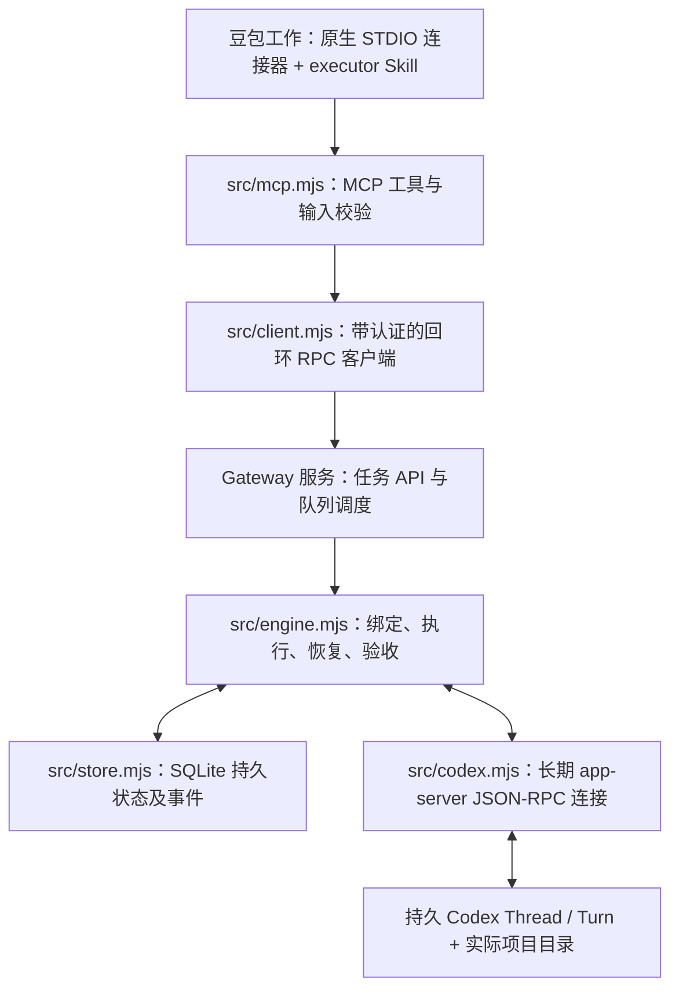
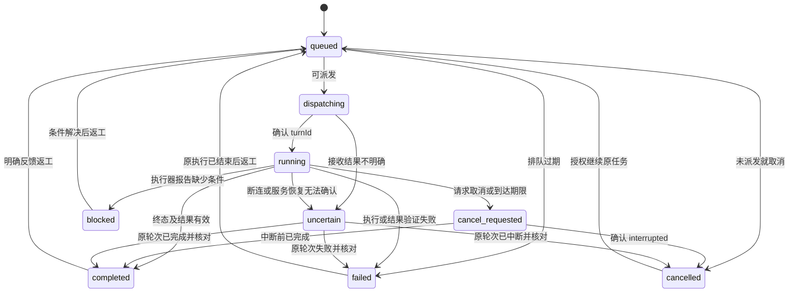

# 架构与持久工作流

本项目将豆包工作作为任务发起者和验收者，将本机 Codex app-server 作为执行器。设计参考 [codex-workbuddy-gateway](https://github.com/dudu555-djiao/codex-workbuddy-gateway) 的监督执行模式，但代码独立实现。参考项目的 WorkBuddy UI/原生桥接方案没有用于这里；本项目不依赖其源码许可证授予任何权利。

本仓库使用 [MIT License](../LICENSE)。文中描述的是实现约束和已验证行为，不是对任意账号、客户端版本或操作系统的兼容保证。

## 进程职责



MCP 适配器与服务分离。豆包可以为连接器启动或结束适配器进程，而持久队列由独立服务持有。macOS LaunchAgent 用于在用户登录会话中维持服务；不是系统级云执行器，睡眠/关机期间没有执行保证。后台任务的持久执行不等于豆包对话持续在线：当前没有心跳自动唤醒或向已经结束的对话主动通知的接口，对话结束后需重新查询原任务。

RPC 只在本机回环地址暴露，使用状态目录中的令牌认证。STDIO 适配器负责把 MCP 请求转换为内部方法调用；内部 `/rpc` 不是远程 MCP 服务器。

## 本机部署布局

默认根目录是当前用户的 `~/Library/Application Support/DoubaoCodexGateway`，其下包含：

```text
DoubaoCodexGateway/
  config.local.json
  installation.json
  deployments/
    <安装时间戳>/
      src/
      node_modules/
      package.json
      package-lock.json
  data/
    gateway.sqlite
    connection.json
    service.log
    service.error.log
    …
```

CLI 安装时把自身运行代码与依赖复制到独立部署目录，写入 `installation.json`，记录源码目录和实际运行目录。LaunchAgent 的工作目录、运行脚本和日志都指向 Application Support。Node 本身不复制，服务使用安装时 `process.execPath` 指向的可执行文件。

开发验证中，直接从 Desktop 启动 LaunchAgent 曾在 Node 执行前出现 `EX_CONFIG`。将运行入口放入 Application Support，可避免把源码所在的桌面目录作为服务启动依赖。执行项目仍受实际目录权限与 Codex 沙箱限制。

`GATEWAY_STATE_DIR` 覆盖 `data` 位置；未指定 `GATEWAY_CONFIG` 时，配置默认位于该状态目录的父目录。安装器把这两个解析后的路径写入服务环境。MCP 适配器必须连接同一个状态目录；`connector-config` 读取安装记录，输出 Node、部署脚本和所需环境变量。

更新源码不会热替换部署代码。应在无活动、排队或未知状态任务时卸载服务再安装，新部署目录与旧部署并存，持久数据保持原位。卸载移除 LaunchAgent 注册并保留停用 plist 备份，不删除任务数据或产物。重新部署后须更新豆包连接器脚本路径。

## 持久数据模型

SQLite 使用 WAL 模式。主要表如下：

| 表 | 作用 |
| --- | --- |
| `bindings` | `workspace` → `threadId`、模型、绑定状态 |
| `runs` | 任务目标、约束、执行状态、验收状态、当前轮次、结果、历史 |
| `requests` | 幂等键、请求指纹、任务 ID |
| `events` | 单调递增序号、任务 ID、事件类型、JSON 内容、时间 |

任务、幂等键和初始事件在同一个 SQLite 事务中创建；状态变更与对应事件也在事务中保存。任务结构以 JSON 保存，事件保留可继续读取的 `seq` 游标。

标识符的职责不同：

- `id`：Gateway 任务 ID，返工保留不变。
- `idempotencyKey`：某个提交或返工意图的稳定键。
- `threadId`：工作区对应的持久 Codex 会话。
- `turnId`：一次真实执行的精确标识；恢复必须匹配它。
- `attempt`：Gateway 内的执行轮次；返工时递增。
- `cursor` / `seq`：任务事件续读位置。

同一键加相同请求指纹返回已有任务；同一键加不同请求被拒绝。提交和返工使用不同的键命名空间。客户端传输不会对失败的请求做透明重试。

## 提交和派发

1. 将工作区解析为真实路径，验证它位于 `allowedRoots` 内。
2. 查找幂等记录；存在则返回已有任务。
3. 取得工作区绑定，必要时调用 `thread/start` 创建非临时会话。
4. 写入 `queued` 任务和初始事件。
5. 调度器检查全局并发容量及工作区/会话占用；已有持久执行记录的 Thread 使用恢复流程，当前进程刚创建且尚未执行的 Thread 直接使用。
6. 先持久化 `dispatching` 与容量占用，再调用 `turn/start`。
7. 保存返回或通知中的 `turnId`，进入 `running`。
8. 接收完成通知，验证结构化结果和产物，将执行结果持久化。

新会话创建发生在任务入队前。绑定本身有 `creating/ready/uncertain` 状态：若会话创建响应丢失，不能盲目再建一个，会要求显式绑定经过核实的 Thread。调度前持久化意图可避免服务重启后把已提交但响应丢失的执行当成未执行任务重发。

Codex 在第一轮执行前可能还没有保存 rollout，因此刚创建的空会话不能立即通过 `thread/resume` 恢复。网关在当前进程中记录新建会话并直接派发；重启后，只有明确得到“没有 rollout”错误且所有关联任务都不存在持久化派发意图/Turn 的情况下，才允许替换从未执行过的空会话。该例外不会重放已经提交的工作；不能排除曾经派发时仍保留错误与人工核查要求。

默认 `maxConcurrent: 1`。允许配置到 4，但同一工作区或同一 Thread 有占用任务时不会继续派发。未知状态也保留占用，因为原始执行可能仍在进行。

## 模型选择与返工

任务显式 `model` 优先于工作区绑定模型，绑定模型优先于 Gateway 配置模型。新建绑定时，网关配置为空则交由 Codex 使用其默认值；绑定建立后会保留模型。修改网关默认模型不会覆盖既有绑定，也不会覆盖任务显式模型。

`codex_models` 读取模型目录，不验证当前账号是否支持实际推理或是否有余额。模型请求失败会保留失败结果，不自动切换另一个模型。

`codex_rework` 保留原任务的显式 `model` 和其他执行设置，只添加反馈并开启新轮次；接口没有模型覆盖字段。如果要切换模型，必须理解当前任务是否有显式覆盖，先确认原始执行终止，再明确决定后续任务或绑定的设置，不能以模型切换掩盖未知状态的重复执行。

## 状态和验收



`review` 单独记录 `pending/accepted`，不是执行状态：

- `completed + pending`：Codex 已完成，结果结构合法，等待豆包独立核验。
- `completed + accepted`：豆包提交了验收证据，网关保存证据并再次检查指定产物路径。
- 返工：仍使用原任务、Thread 和目录，当前结果进入历史，`attempt` 加一，`review` 回到 `pending`。

`codex_accept` 不运行验收测试，也不证明传入文字一定属实。Skill 要求豆包根据文件、测试和用户标准检查后再调用。

## 结果与文件

Gateway 要求 Codex 最终输出一个 JSON 对象：

```json
{
  "status": "completed",
  "text": "完成说明以及执行过的验证",
  "artifacts": ["relative/path/to/file"],
  "data": null
}
```

执行器也可以报告 `status: blocked`。`output: json` 要求执行器把结果 JSON 编码为非空的 `data` 字符串，网关再解析成对外的结构化数据；其他输出模式为 `null`。`output: artifacts` 要求存在文件产物。无效结果进入 `failed`，而非假设成功。

每个文件必须存在、是普通文件、解析后的真实路径位于任务工作区中。符号链接指向外部目录会被拒绝。文件清单转为 `{path, name, bytes}`：`path` 是绝对路径，`name` 是工作区内相对路径。

豆包接收摘要和路径，然后向用户交付；网关不会自动上传文件、启动预览服务或发布网站。文件存在性校验也不等于内容验收。

## 超时与恢复语义

长轮询等待最多 50 秒，读的是已持久化的状态和事件。`timedOut` 不取消任务，不创建新 Turn，也不构成重新提交的依据。任务自身的 `timeoutSeconds` 则用于调度期限：未派发任务过期会失败，已派发任务过期会请求中断。

Codex 断连会将占用容量的任务标记 `uncertain`。服务恢复和 `codex_recover` 都读取原 Thread 的 Turns，并只用持久化的 `turnId` 匹配：

- 精确轮次已完成、失败或中断：按真实终态处理。
- 精确轮次仍不能确认结束：保留 `uncertain`，不继续派发冲突任务。
- 没有 `turnId` 或找不到该轮次：保留 `uncertain`，提示人工检查。

恢复时绝不将最新 Turn 当成原始 Turn，也不会自动调用 `turn/start` 重做工作。本版不提供强制清空未知状态、强制接受未完成结果或自动补交新任务的操作。

取消请求会调用原 Thread/Turn 的 `turn/interrupt`。发送成功本身不表示执行已停止；收到真实中断终态才能标记 `cancelled`。已发生的文件变更保留，网关不做自动回滚。

## 权限范围

配置的 `allowedRoots` 检查可绑定和提交的工作目录输入。Gateway 用 `workspace-write` 和 `approvalPolicy: never` 开始/恢复 Codex 会话。`never` 表示执行器不能通过网关升级权限；并不授予无限访问。`workspace-write` 主要限制写入，不等价于完整读取隔离，允许根目录也不能被解释为所有底层工具的读取白名单或绝对安全保证。

收到命令、文件修改或权限提升审批时，网关返回拒绝或空权限；无法代答的用户输入请求不会被编造答案。执行器应给出阻塞原因，让用户直接处理后再继续。

服务可以调用该本机 Codex 配置可用的工具。因此工作区允许列表不是多租户安全隔离，网关也不替代 Codex 本身的沙箱。本版不负责管理账号、转移凭据、切换组织或修改全局 Codex 设置。

## 可见性与范围

Codex app-server 会话是本机持久执行状态。它们是否显示在 Codex 桌面应用任务侧栏，取决于桌面端与运行器的兼容和同步行为，本项目不对此作保证，也没有实现桌面 UI 注入。

事件通过 `events/wait` 拉取，当前接口不是 SSE 推送订阅，也不会自动给豆包发一条新消息。等待、重启和 SQLite 核对本身不会启动模型生成，但实际提交与返工会使用 Codex 的模型与额度。模型列表是目录信息，不是账号权益或余额证明。

目前没有承诺云端执行、关机续跑、网页自动托管、审批自动放行、跨账号同步、自动 Git 提交或自动发布。这些能力应在有明确需求时独立设计和验收。
